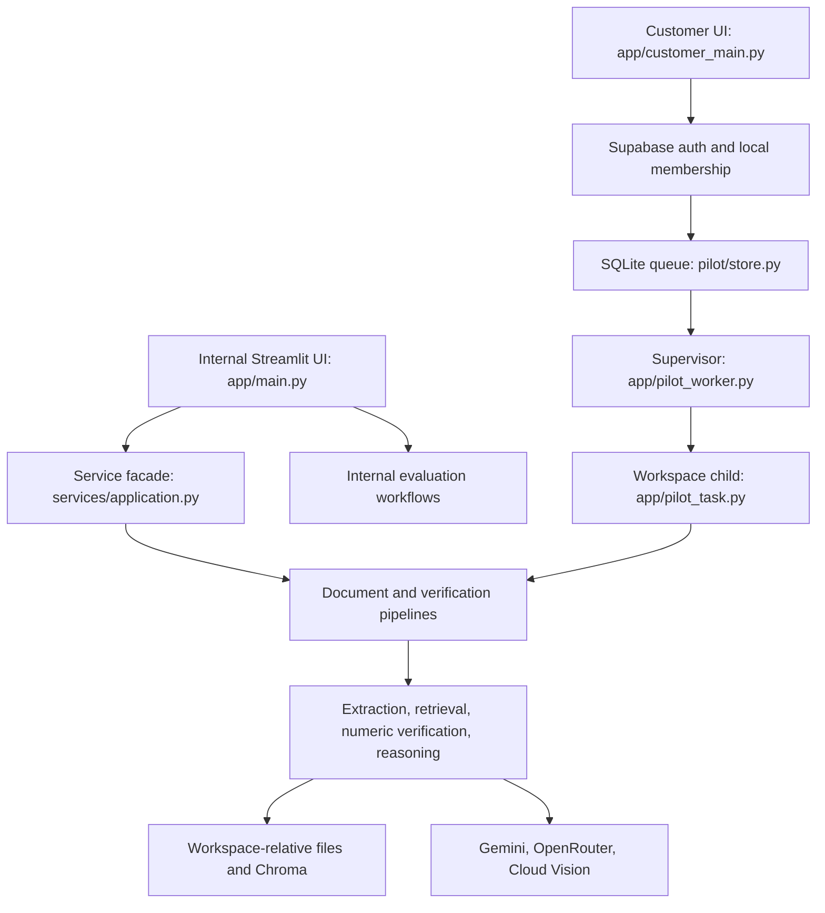

<!-- refreshed: 2026-10-30 -->
# Architecture

**Analysis Date:** 2026-10-30

## System Overview

The graph describes the module connections observed in source. Live providers and end-to-end runtime behavior were not exercised during mapping; see `TESTING.md` for validation limits.

## Component Responsibilities

| Component | Responsibility | File |
|-----------|----------------|------|
| Internal entry point | Set root/import path, load configuration, configure logs, start dashboard | `app/main.py` |
| Internal workspace | Document selection, claim workflow, evaluation/history navigation | `app/ui/workspace.py` |
| Application facade | Lazy delegation to processing, verification, and page rendering | `app/services/application.py` |
| Document pipeline | Validate source, extract modalities, build evidence/chunks/index, persist readiness | `app/pipelines/document_pipeline.py` |
| Verification pipeline | Parse claims, scope sources, retrieve, resolve evidence, check arithmetic or grounded reasoning | `app/pipelines/verification_pipeline.py` |
| Model gateway | Provider routing, schema validation, tracing, bounded configuration | `app/services/model_gateway.py` |
| Customer access | Supabase identity verification and workspace selection | `app/pilot/auth.py` |
| Customer control store | Memberships, documents, queue, decisions, path constraints | `app/pilot/store.py` |
| Worker supervisor | Claim one job, heartbeat, launch and monitor a workspace child | `app/pilot_worker.py` |
| Job task | Process/verify/delete, checkpoint results, validate source/code/model identity | `app/pilot_task.py` |
| Evaluation workflows | Dataset review, retrieval/verdict/ablation/hallucination experiments | `app/evaluation/` |

## Pattern Overview

**Overall:** Layered Python application with Streamlit presentation, a thin service facade, domain pipelines, filesystem persistence, and a SQLite-backed customer job queue.

**Key Characteristics:**
- The internal dashboard runs synchronous workflows through `app/services/application.py`.
- The customer interface submits durable jobs; a separate supervisor executes them in fresh child processes (`app/pilot_worker.py`).
- Shared domain code relies on relative `data/` paths. Workspace-specific working directories isolate customer artifacts (`app/pilot_task.py`).
- Most cross-layer records are dictionaries; selected model-response boundaries use Pydantic (`app/pipelines/verification_pipeline.py`, `app/verification/grounded_numeric.py`).

## Layers

**Presentation:**
- `app/ui/` owns internal Streamlit views; `app/pilot/ui.py` owns customer views.
- `app/customer_main.py` registers only the authenticated customer page using explicit navigation.
- UI modules also manage Streamlit session state and some local report persistence (`app/ui/workspace.py`).

**Application orchestration:**
- `app/services/application.py` is the stable internal dashboard facade.
- `app/pipelines/` coordinates domain functions; `app/pilot_task.py` adapts those functions to queued customer jobs.
- Evaluation service modules such as `app/services/evaluation_dataset.py` re-export `app/evaluation/` implementations.

**Domain and infrastructure:**
- `app/extraction/` parses PDFs, tables, layouts, OCR, chart regions, and evidence chunks.
- `app/retrieval/` supplies embeddings, vector/BM25 support, and reranking.
- `app/verification/` parses assertions and resolves values, units, periods, and calculations.
- `app/reasoning/` fuses evidence and defines reasoning/vision schemas.
- `app/services/runtime.py` supplies JSON IO, hashing, retries, and Gemini client creation.

## Data Flow

### Document Processing

1. Validate PDF bytes and the document identifier before accepting a source (`app/pipelines/document_pipeline.py:28`, `app/services/document_guards.py:10`).
2. Persist source PDF and processing metadata under relative `data/documents/` and `data/processed/`.
3. Extract native pages/layout/tables; apply optional OCR on weak-text pages and chart analysis on requested pages (`app/pipelines/document_pipeline.py`).
4. Preserve source addresses, page geometry, table context, and explicit readable chart facts in evidence records.
5. Build chunks and embeddings; only mark the document ready after usable evidence and an index exist (`app/extraction/chunker.py`, `app/retrieval/embeddings.py`).
6. Persist errors with stage/type metadata and re-raise processing failures (`app/pipelines/document_pipeline.py`).

### Claim Verification

1. Parse the original assertion into subclaims (`app/pipelines/verification_pipeline.py:219`, `app/verification/claim_parser.py`).
2. Require ready documents and resolve company scope; unnamed claims require one selected document (`app/pipelines/verification_pipeline.py:46`).
3. Call document-scoped search, fuse vector and BM25 rankings, rerank candidates, and resolve chunk IDs back to original evidence (`app/pipelines/verification_pipeline.py:73`, `app/retrieval/vector_store.py:36`). Search validates vector-index coverage before querying.
4. Select source operands and perform Python arithmetic with explicit unit/period checks (`app/verification/grounded_numeric.py:329`, `app/verification/financial_calculations.py`).
5. Fuse evidence and return UNKNOWN for unresolved conflicts; deterministic numeric comparisons avoid another model explanation call.
6. For qualitative claims, require cited source IDs and verbatim quotes from supplied evidence; operational/validation errors retain `status="error"` (`app/pipelines/verification_pipeline.py`).
7. Aggregate subclaims into SUPPORTED, CONTRADICTED, PARTIALLY_SUPPORTED, or UNKNOWN; consumers must also inspect status/pause fields.

### Customer Queue Execution

1. Verify Supabase identity and resolve a local membership (`app/pilot/auth.py`, `app/pilot/store.py`).
2. Validate and enqueue processing, verification, or deletion with workspace ownership (`app/pilot/store.py`).
3. Claim one queued job using a SQLite transaction and a run token (`app/pilot_worker.py:42`).
4. Start `app/pilot_task.py` in the assigned workspace, retaining project imports but using workspace-relative data paths.
5. Validate current membership, source hashes, code fingerprint, and model snapshot; checkpoint completed subclaims.
6. Complete, pause, or fail explicitly. Retry is an operator/user action rather than an automatic conversion to UNKNOWN (`app/pilot_task.py`).

**State Management:**
- Streamlit session state holds UI state and browser auth tokens (`app/pilot/auth.py`, `app/ui/workspace.py`).
- SQLite stores durable customer control state (`app/pilot/store.py`).
- JSON/files and Chroma store domain artifacts; atomic temporary-file replacement is used for runtime JSON writes (`app/services/runtime.py`).

## Key Abstractions

**Access:**
- Frozen principal/workspace/expiry record; service operations call membership authorization (`app/pilot/store.py`).

**Evidence and result dictionaries:**
- Evidence carries document/source IDs, page, modality, content, tables/facts, and geometry (`app/pipelines/document_pipeline.py`).
- Results carry status separately from verdict, plus citations, calculation/comparison, error stage, and pause metadata (`app/pipelines/verification_pipeline.py`).

**ModelConfig and typed responses:**
- Frozen model configuration with context-local overrides; Pydantic validates generated payloads (`app/services/model_gateway.py`).

## Entry Points

- `streamlit run app/main.py`: internal document verification and evaluation UI.
- `streamlit run app/customer_main.py`: authenticated customer workspace UI.
- `python app/pilot_worker.py`: long-running customer supervisor.
- `python app/pilot_admin.py`: membership and interrupted-job administration.
- `app/pilot_task.py`: private child execution target, launched by the supervisor.
- `app/ui_preview.py`, `app/hallucination_preview.py`: auxiliary internal views, not the customer entry point (`docs/CUSTOMER_SETUP.md`).

## Architectural Constraints

- **Working directory:** Do not change the public customer process's working directory per request. Legacy relative paths are isolated using job subprocesses (`app/pilot_worker.py`).
- **Concurrency:** One supervisor serializes jobs; OS locks prevent another supervisor on the same filesystem (`app/pilot_worker.py`).
- **Global state:** Reranker model, embedding pacing/cache locks, and BM25 cache are process-local (`app/retrieval/reranker.py`, `app/retrieval/embeddings.py`, `app/retrieval/vector_store.py`).
- **Context state:** Gateway configuration/call capture and request correlation use `ContextVar` (`app/services/model_gateway.py`, `app/services/observability.py`).
- **Resume identity:** Application Python source changes invalidate the task code fingerprint; model/source changes can also block resume (`app/pilot_task.py`).
- **Imports:** Entry points add `app/` to `sys.path`; domain imports are `services.*`, `retrieval.*`, etc., rather than consistently `app.*`.
- **Isolation:** A workspace child is an application boundary, not an OS sandbox for hostile PDFs (`docs/CUSTOMER_SETUP.md`).

## Anti-Patterns

### Inferring Behavior from Commented Implementations

Large historical implementations remain commented out beside active code (`app/retrieval/vector_store.py`, `app/services/model_gateway.py`, `app/services/runtime.py`). Trace active definitions and callers; historical retrieval defaults and helpers do not establish current behavior.

### Treating Verdict as Execution Status

An error result can retain `verdict="UNKNOWN"` while explicitly setting `status="error"` (`app/pipelines/verification_pipeline.py`). Inspect status/pause before counting factual predictions, exporting completion metrics, or presenting a successful review.

## Error Handling

- Typed document/verification failures identify stages (`app/services/document_errors.py`, `app/services/verification_errors.py`).
- Pipelines persist useful state, preserve warnings for partial modality coverage, and retain explicit failures for operational errors.
- Customer job/UI paths avoid exposing raw provider exception bodies (`app/pilot_task.py`).

## Cross-Cutting Concerns

**Logging:** Allowlisted JSON events and request correlation (`app/services/observability.py`).
**Validation:** PDF checks, ID/path constraints, Pydantic schemas, source-hash checks, operand/citation validation.
**Authentication:** Supabase user verification plus local membership checks (`app/pilot/auth.py`, `app/pilot/store.py`).

---

*Architecture analysis: 2026-10-30*
