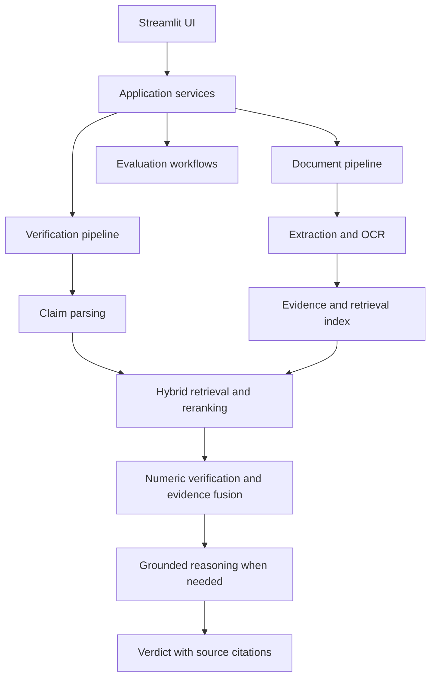

# Multimodal Financial Claim Verifier

A Streamlit application for verifying financial assertions against uploaded PDF reports, with source pages, structured tables, chart/OCR evidence and deterministic calculations.

## Problem and solution

Financial reports distribute information across paragraphs, tables, charts and footnotes. Text-only retrieval can lose units, periods, row labels or relevant visual evidence. This application retrieves evidence across those modalities, checks numerical assertions in Python and presents a verdict with auditable citations.

## Architecture



`app/main.py` starts the UI and logging. `app/ui/` owns Streamlit controls and presentation. `app/services/application.py` provides the dashboard's processing, verification and rendering entry points. Evaluation service modules expose the existing evaluation workflows without duplicating them. `app/pipelines/` coordinates the domain modules under `extraction/`, `retrieval/`, `verification/` and `reasoning/`.

This is an incremental refactor: some UI code still reads local reports and manages session state. Evaluation workflows remain under `app/evaluation/`, and several modules share infrastructure helpers from `services/`. It is not a complete migration to an abstract repository/storage layer.

Important files:

- `app/pipelines/verification_pipeline.py`: scopes documents, retrieves evidence, checks calculations, validates citations and produces results.
- `app/verification/financial_calculations.py`: deterministic growth, absolute change, margins, CAGR and percentage-point calculations.
- `app/verification/grounded_numeric.py`: resolves source cells, units and periods before arithmetic.
- `app/ui/evidence.py`: source cards, relevant table rows and links to the original page.
- `app/services/observability.py`: correlated JSON lifecycle events.

## Local setup

Use your existing virtual environment and dependencies. For a new environment:

```bash
python -m venv .venv
# Windows PowerShell:
.venv\Scripts\Activate.ps1
pip install -r requirements.txt
streamlit run app/main.py
```

Configure your existing `.env` or Streamlit secrets. Never commit keys. The established setup uses Gemini document/query embeddings and OpenRouter text/vision routing. Set `GOOGLE_API_KEY` (or the supported Gemini key alias), `LLM_PROVIDER=openrouter`, `OPENROUTER_API_KEY`, `OPENROUTER_TEXT_MODEL` and a vision-capable `OPENROUTER_VISION_MODEL` as required by your installed model settings. Model availability and account quotas must be checked with the provider.

The existing index uses `gemini-embedding-001`, 768 dimensions, collection `evidence_v2_4251d7d3a135`. Document and query embeddings must use the same model/dimensions. Changing the reasoning model does not require rebuilding these embeddings. Changing the embedding model does require a compatible new index.

## Workflow

1. Upload and process a PDF. Validate the PDF, extract text/layout/tables, optionally process OCR/charts, persist evidence and build the retrieval index.
2. Select a ready document and enter an assertion. Compound claims are checked as individual assertions.
3. Inspect the verdict, calculation and evidence. View Page displays the original page beside the evidence and highlights a region when usable coordinates exist.
4. Calculations expand for contradictions and remain collapsed otherwise. Original values are shown when retained, alongside normalized values and currency/unit metadata. Missing calculations retain a reason. Signed differences follow the comparison's claimed-minus-actual convention.
5. Review evaluation drafts before export; building drafts and approving them are separate actions.

## Worked example — illustrative, not a measured result

Claim: “International revenue grew 40% from 2024 to 2025.”

| Source period | Original value | Normalized USD |
| --- | ---: | ---: |
| 2024 | $10B | 10,000,000,000 |
| 2025 | $11B | 11,000,000,000 |

Actual growth = `(11 - 10) / 10 × 100 = 10%`.

Claimed minus actual = `40 - 10 = +30 percentage points`.

Verdict: **CONTRADICTED**, provided the source establishes the stated segment, periods, units and currency. The real UI cites actual document/evidence IDs and PDF page positions; this synthetic example has no fabricated page citation.

## Evaluation results

The following is a historical completed retrieval baseline from `20261023_110510_e9ec5804(1).json`, before this Day 10 refactor. Claim parsing was enabled. Results are measured, not target values.

| Query level / stage | Recall@5 | Recall@10 | MRR@20 |
| --- | ---: | ---: | ---: |
| Complete claims / initial | 46.67% | 61.33% | 0.3300 |
| Complete claims / reranked | 43.33% | 60.67% | 0.2839 |
| Subclaims / initial | 42.86% | 57.14% | 0.3207 |
| Subclaims / reranked | 51.02% | 61.22% | 0.3493 |

There were 75 eligible complete claims and 49 eligible subclaims. Queries without positive gold evidence (25 complete claims and 11 subclaims) were excluded. Recall measures the proportion of distinct gold evidence items recovered; it is not merely whether one correct item appeared. MRR@20 uses the rank of the first correct evidence item within the retrieval window. Reranking reduced complete-claim performance while improving subclaim performance; it is not uniformly beneficial.

| Additional metric | Status |
| --- | --- |
| Final-verdict accuracy and per-class precision/recall/F1 | Pending completed, valid run after verification fixes |
| Macro F1 across the four verdicts | Pending completed, valid run |
| Numerical accuracy | Not yet measured with an explicit denominator and tolerance |
| Text / +tables / +charts / +calculations ablation | Pending complete comparable reports |
| Hallucination resistance | In progress; requires completed predictions and human grounding review |

An earlier partial verdict run produced only UNKNOWN among completed predictions and suffered service failures. It is a debugging baseline, not valid full-dataset performance. Do not combine it with the completed retrieval baseline as if they described one successful final experiment.

The reviewed main dataset contains 100 claims: 25 per verdict, 50 straightforward and 50 difficult (35 isolated, 15 combined). The separate hallucination set contains 20 reviewed adversarial claims. Review supports UNKNOWN for missing evidence, CONTRADICTED for explicit opposing evidence, and PARTIALLY_SUPPORTED for mixed compound assertions. No automatic blanket UNKNOWN assignment is used as gold.

Record document hashes, dataset version, model configuration, code version and completion/error counts with every experiment. Source/code changes can invalidate prediction-cache fingerprints. Keep historical reports and label reruns clearly. Operational failures and quota pauses are not factual verdicts and must not enter accuracy denominators as successful UNKNOWN predictions. Report completion coverage alongside metrics.

## Error behavior

| Condition | Behavior |
| --- | --- |
| Invalid, empty or password-protected PDF | Reject before saving/replacing source bytes |
| Scanned or weak-text pages | Attempt enabled OCR; record coverage warnings |
| No native text or no extracted tables | Record warning; allow other usable evidence |
| Malformed/empty table | Skip the malformed table and warn; retain valid row addresses |
| No usable evidence or zero chunks | Mark processing failure; do not create an empty ready index |
| No retrieved evidence | Completed UNKNOWN with a reason; no grounded answer generation |
| Missing/ambiguous numerical operands | Calculation unavailable with a reason; no invented values |
| OCR returns an unsuccessful result | Record warning and missing coverage |
| OCR raises an exception | Stop processing and surface an operational error |
| Model/retrieval/source-resolution failure | Explicit error status; preserve error stage and quota pause handling |

A successful transport response is not evidence of a correct assertion. Citation existence and verbatim quote validation do not by themselves prove entailment. Human grounding review remains necessary for the hallucination experiment.

## Logging

New JSON events are written to stderr and `data/logs/app-<process-id>.jsonl`. Each process rotates its own log at approximately 5 MB with three backups. Override the directory with `CLAIM_VERIFIER_LOG_DIR`. If the directory is unwritable, logging falls back to stderr with a warning.

Events cover upload acceptance, extraction start, tables/charts found, weak-text/OCR conditions, document readiness, claim receipt, retrieval counts, numerical availability, gateway model calls and final verdict/error. Request IDs correlate nested synchronous workflow events. The dedicated event log records metadata, not raw claims, PDF contents, prompts, credentials or exception text. Existing third-party/provider logs retain their own policies. Logs are local diagnostics, not a durable multi-worker audit database.

## Limitations

- OCR and chart extraction can be wrong or incomplete; candidate-page scans can miss charts.
- Unreadable/estimated chart values cannot safely substitute for explicit values.
- Complex tables, footnotes, fiscal calendars, quarterly versus annual scope and ambiguous currency can prevent verification.
- Original document precision is preserved only when retained by extraction; normalized floating-point calculations are not arbitrary-precision accounting.
- A negative or zero growth baseline may require UNKNOWN rather than an undefined percentage.
- Model confidence is uncalibrated and must not be presented as measured correctness probability.
- Retrieval can miss relevant evidence. UNKNOWN means insufficient available evidence, not proof that a statement is false or absent from the entire PDF.
- PDF inputs are supported; other source formats need separate ingestion work.
- Local filesystem storage and Streamlit hosting need a separate deployment design. This update does not make the app deployable to Vercel as-is.
- Refactoring has not been runtime-tested in this delivery. Follow the manual checklist on your own machine.
